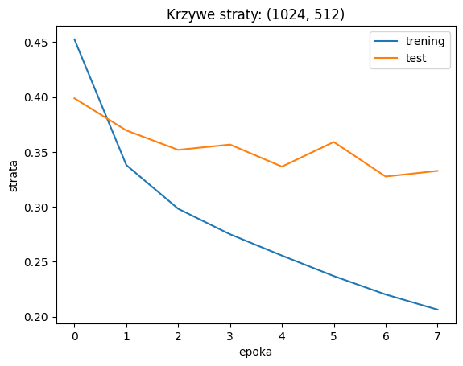
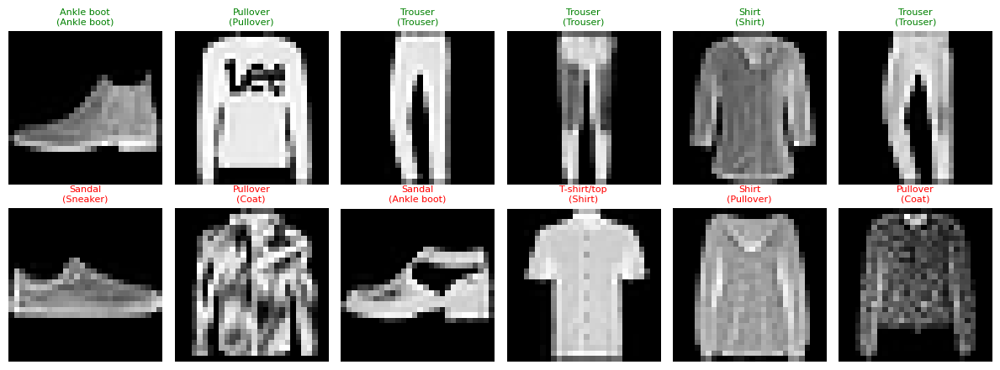
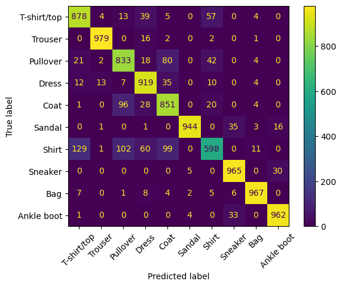

# Sprawozdanie laboratoryjne

**Przedmiot:** Uczenie głębokie do rozpoznawania obiektów
**Zajęcia nr / temat:** 1 / Obraz jako dane; pierwszy klasyfikator obrazów (MLP)
**Autor / grupa:** Maciej Próchniak / Gr.3
**Data:** 20.10.2026

## 1. Cel ćwiczenia

Celem ćwiczenia było wytrenowanie sieci MLP do rozpoznawania ubrań na obrazkach, porównanie kilku architektur sieci oraz wskazanie ubrań, które sieć najczęściej myli ze sobą.

Wybrałem zbiór FashionMNIST z obrazami odzieży. Obrazy są małe i mają jeden kanał, więc trening jest szybki i łatwo było porównać pięć wariantów. Nie wybrałem CIFAR-10, bo dla MLP jest znacznie trudniejszy i dokładność byłaby prawdopodobnie wyraźnie niższa.

## 2. Metoda i implementacja

**Narzędzia i dane.** PyTorch, torchvision, matplotlib, pandas i scikit-learn. Dane to zbiór FashionMNIST: 70 000 obrazów 28 × 28 w skali szarości, podzielonych na 10 klas (60 000 treningowych i 10 000 testowych). Obrazy zamieniono na tensory (`ToTensor()`) i znormalizowano (`Normalize(0.2860, 0.3530)`). Paczki miały 128 obrazów (trening) i 256 (test).

**Model.** Każdy wariant to sieć `nn.Sequential`: obraz jest spłaszczany do 784 wartości i przechodzi przez jedną, dwie lub trzy warstwy ukryte z funkcją `ReLU`, a na wyjściu jest 10 logitów. Model bazowy ma kolejno 784, 256, 128 i 10 neuronów w warstwach (wejście, dwie warstwy ukryte, wyjście).

**Konfiguracja.** `CrossEntropyLoss`, optymalizator Adam (`lr = 1e-3`), 8 epok, `torch.manual_seed(0)` przed utworzeniem każdego modelu. Sprawdzono architektury `(256, 128)` (bazowa), `(128,)`, `(512,)`, `(512, 256, 128)` i `(1024, 512)`. Macierz pomyłek policzono funkcją `confusion_matrix`.

**Kod.** Cały kod znajduje się w pliku `lab1_Maciej_Próchniak.ipynb` w repozytorium: https://github.com/mprochniak1/Rozpoznawanie_obiektow

## 3. Wyniki

**Porównanie wariantów architektury** (accuracy na zbiorze testowym po 8 epokach):

| Architektura | Liczba parametrów | Accuracy [%] |
|---|---:|---:|
| baza (256, 128) | 235 146 | 88,68 |
| (128,) | 101 770 | 88,12 |
| (512,) | 407 050 | 88,23 |
| (512, 256, 128) | 567 434 | 88,40 |
| (1024, 512) | 1 333 770 | 88,96 |

Model bazowy miał accuracy 88,68%. Najlepszy był wariant `(1024, 512)` z wynikiem 88,96%, czyli o 0,28 punktu procentowego więcej, ale z ok. 5,7 razy większą liczbą parametrów.

**Krzywe uczenia najlepszego wariantu `(1024, 512)`:**

**Przykładowe predykcje** (pierwszy wiersz: trafne, drugi: błędne; w nawiasie prawdziwa klasa):

**Macierz pomyłek** (wariant `(1024, 512)`, zbiór testowy):

Pięć najczęstszych pomyłek:

| Klasa prawdziwa | Klasa przewidziana | Liczba pomyłek |
|---|---|---:|
| Shirt | T-shirt/top | 129 |
| Shirt | Pullover | 102 |
| Shirt | Coat | 99 |
| Coat | Pullover | 96 |
| Pullover | Coat | 80 |

## 4. Analiza i interpretacja

**Architektury.** Wszystkie warianty mają accuracy między 88,12% a 88,96%, więc różnice są małe (poniżej 1 punktu procentowego). Największa sieć `(1024, 512)` wypadła najlepiej, ale model bazowy był lepszy od większych `(512,)` i `(512, 256, 128)`, więc nie widać, żeby więcej parametrów wyraźnie poprawiało wynik. Każdy wariant uruchomiłem raz, więc takie małe różnice mogą wynikać z losowości.

**Przeuczenie.** Strata treningowa (`train_loss`) spada przez wszystkie epoki, z ok. 0,45 do ok. 0,21. Strata testowa (`test_loss`) po kilku epokach przestaje wyraźnie spadać i waha się w okolicy 0,33-0,36. Różnica między krzywymi rośnie, co może wskazywać na lekkie przeuczenie.

**Błędy.** Na siatce błędy dotyczą podobnych ubrań (Coat jako Pullover, Shirt jako T-shirt/top, Pullover jako Shirt) i butów (Sneaker oraz Ankle boot jako Sandal). Macierz pomyłek to potwierdza: najtrudniejsza jest para Shirt i T-shirt/top (129 pomyłek w jedną stronę i 57 w drugą), a Shirt ma najgorszą skuteczność (598 z 1000, czyli 59,8%). Druga trudna para to Coat i Pullover (96 i 80). Najlepiej wypadają Trouser, Sneaker, Bag i Ankle boot (co najmniej 960 z 1000). MLP po spłaszczeniu obrazu do 784 liczb nie widzi, które piksele leżą obok siebie, co może tłumaczyć mylenie podobnych ubrań.

**Ograniczenia.** Wariant wybrałem na podstawie zbioru testowego (nie było zbioru walidacyjnego), a każdą konfigurację uruchomiłem raz, więc wyniki mogą się trochę wahać.

## 5. Wnioski

Model bazowy osiągnął 88,68% accuracy, a najlepszy wariant `(1024, 512)` 88,96%, więc zmiana architektury dała poprawę o mniej niż 1 punkt procentowy. Wygląda na to, że większym ograniczeniem jest spłaszczenie obrazu niż liczba parametrów. Krzywe `train_loss` i `test_loss` mogą wskazywać na lekkie przeuczenie, a macierz pomyłek pokazuje, że najtrudniejsze są klasy Shirt, T-shirt/top, Pullover i Coat. Poprawę mogłaby dać sieć splotowa (CNN) oraz zbiór walidacyjny do wyboru architektury.
