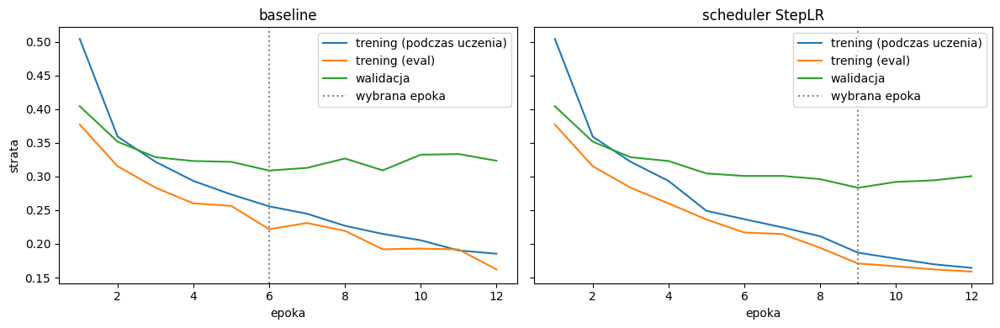
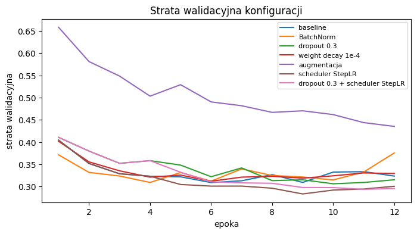

# Sprawozdanie laboratoryjne

**Przedmiot:** Uczenie głębokie do rozpoznawania obiektów
**Zajęcia nr / temat:** 2 / Trenowanie i strojenie klasyfikatora obrazów
**Autor / grupa:** Maciej Próchniak / Gr.3
**Data:** 27.10.2026

## 1. Cel ćwiczenia

Celem ćwiczenia było poprawienie jakości i generalizacji klasyfikatora MLP z zajęć 1. Sprawdzono pięć technik (BatchNorm, dropout, weight decay, augmentację danych i harmonogram współczynnika uczenia), każdą osobno względem baseline'u, a potem kombinację tych, które pomogły. Model wybrano według najniższej straty walidacyjnej, a na zbiorze testowym oceniono go dopiero na końcu.

Pracowałem na zbiorze FashionMNIST, tak jak na zajęciach 1, żeby baseline był ten sam co wtedy.

## 2. Metoda i implementacja

**Narzędzia i dane.** PyTorch, torchvision, matplotlib i pandas. Zbiór FashionMNIST ma 60 000 obrazów treningowych i 10 000 testowych (28 × 28, skala szarości, 10 klas). Z części treningowej wydzielono na stałe 10 000 obrazów walidacyjnych (losowa permutacja z torch.Generator().manual_seed(42)), więc do uczenia zostało 50 000 obrazów. Tego samego podziału użyto we wszystkich wariantach, a zbiór testowy wykorzystano tylko do oceny końcowej. Obrazy zamieniono na tensory i znormalizowano (Normalize(0.2860, 0.3530)). Augmentacja (RandomHorizontalFlip() i RandomCrop(28, padding=4)) działała tylko na danych treningowych. Walidacja, test i ocena treningu w trybie eval() były zawsze bez augmentacji.

**Model.** MLP o warstwach 784, 256, 128 i 10 neuronów z funkcją ReLU, czyli model bazowy z zajęć 1. Klasa MLP ma dwa przełączniki: use_bn dodaje BatchNorm1d po każdej ukrytej warstwie liniowej, a p_drop dodaje Dropout po każdej funkcji ReLU.

**Konfiguracja.** CrossEntropyLoss, optymalizator Adam (lr = 1e-3), paczki po 128 obrazów (trening) i 256 (ocena), 12 epok dla każdego wariantu, torch.manual_seed(0) przed utworzeniem każdego modelu. Baseline nie ma regularyzacji ani augmentacji. Każdy z pięciu wariantów zmienia względem niego jeden czynnik:

| Wariant | Zmiana względem baseline'u |
|---|---|
| BatchNorm | use_bn=True |
| dropout 0.3 | p_drop=0.3 |
| weight decay 1e-4 | weight_decay=1e-4 w Adamie |
| augmentacja | losowe odbicie poziome i przesunięcie o maksymalnie 4 piksele |
| scheduler StepLR | StepLR(step_size=4, gamma=0.5), czyli lr równe 1e-3, 5e-4 i 2,5e-4 w epokach 1-4, 5-8 i 9-12 |

Kombinację zbudowano ze zmian, które obniżyły najniższą val_loss względem baseline'u. Były to dropout 0.3 i scheduler StepLR.

**Wybór modelu i luka generalizacji.** Po każdej epoce liczono train_loss (średnia strata z uczenia, w trybie train(), z dropoutem i augmentacją), train_eval_loss (strata na 50 000 obrazów treningowych w trybie eval(), bez augmentacji), val_loss i accuracy walidacyjną. W każdym wariancie przywrócono wagi z epoki o najniższej val_loss, a spośród wariantów wybrano ten z najniższą val_loss. Luka generalizacji to val_loss - train_eval_loss w wybranej epoce. Accuracy testową policzono raz, po wyborze modelu, dla wybranego wariantu i baseline'u.

**Kod.** Cały kod znajduje się w pliku lab2_Maciej_Próchniak.ipynb w repozytorium: https://github.com/mprochniak1/Rozpoznawanie_obiektow

## 3. Wyniki

**Wyniki na zbiorze walidacyjnym** (wybrana epoka to epoka o najniższej val_loss):

| Konfiguracja | Wybrana epoka | val_loss | Accuracy walidacyjna [%] | Luka train-val |
|---|---:|---:|---:|---:|
| baseline | 6 | 0,3089 | 89,19 | 0,0872 |
| BatchNorm | 4 | 0,3091 | 88,76 | 0,0766 |
| dropout 0.3 | 10 | 0,3061 | 89,10 | 0,0763 |
| weight decay 1e-4 | 6 | 0,3118 | 88,81 | 0,0810 |
| augmentacja | 12 | 0,4352 | 84,10 | 0,0137 |
| scheduler StepLR | 9 | 0,2833 | 90,01 | 0,1124 |
| dropout 0.3 + scheduler StepLR | 11 | 0,2936 | 89,45 | 0,0795 |

Najniższą val_loss (0,2833) miał scheduler StepLR i ta konfiguracja została wybrana. Jego accuracy walidacyjna wyniosła 90,01%, czyli o 0,82 punktu procentowego więcej niż baseline (89,19%).

**Krzywe uczenia baseline'u i wybranego wariantu** (linia kropkowana to wybrana epoka):

**Strata walidacyjna wszystkich konfiguracji:**

**Accuracy testowa** (liczona raz, po wyborze konfiguracji):

| Model | Accuracy testowa [%] |
|---|---:|
| baseline | 88,45 |
| scheduler StepLR | 89,60 |

Wybrany model poprawił accuracy testową o 1,15 punktu procentowego względem baseline'u.

## 4. Analiza i interpretacja

**Baseline.** val_loss spada do 0,3089 w 6. epoce, a potem waha się w okolicy 0,31-0,33, chociaż train_eval_loss dalej spada, do ok. 0,16 w 12. epoce. Rosnąca różnica między krzywymi wskazuje na przeuczenie po 6. epoce, podobnie jak na zajęciach 1.

**Pojedyncze ulepszenia.** Tylko scheduler StepLR wyraźnie obniżył val_loss (z 0,3089 do 0,2833). Do 4. epoki jego krzywe pokrywają się z baseline'em, bo lr jest taki sam, a po każdym zmniejszeniu lr (od 5. i od 9. epoki) strata walidacyjna spada. Dropout dał niewielką poprawę (0,3061), a minimum osiągnął dopiero w 10. epoce, co może oznaczać, że spowalnia przeuczenie. BatchNorm najszybciej obniżył stratę (minimum już w 4. epoce), ale później val_loss rosła i w 12. epoce doszła do ok. 0,38. Weight decay 1e-4 praktycznie nic nie zmienił (0,3118). Różnice między baseline'em, BatchNormem, dropoutem i weight decay wynoszą najwyżej ok. 0,006, więc przy jednym uruchomieniu mogą wynikać z losowości.

**Augmentacja.** Augmentacja wyraźnie pogorszyła wynik: val_loss 0,4352 i accuracy 84,10%. Luka train-val jest najmniejsza (0,0137), ale przy tak słabych wynikach oznacza niedouczenie, a nie lepszą generalizację. Strata walidacyjna spadała do ostatniej epoki, więc 12 epok to prawdopodobnie za mało. Możliwe też, że przesunięcie o 4 piksele jest za mocne dla MLP, który po spłaszczeniu traktuje przesunięty obraz jak zupełnie inne dane wejściowe.

**Kombinacja.** Połączenie dropoutu ze schedulerem (0,2936) było lepsze od baseline'u, ale gorsze od samego schedulera. Najniższą val_loss miało w 11. epoce, a w ostatnich epokach strata zmieniała się już niewiele. Możliwe, że dropout przy zmniejszonym lr spowalnia uczenie i model nie zdążył dopasować się tak dobrze jak sam scheduler.

**Luka generalizacji.** Wybrany wariant ma większą lukę niż baseline (0,1124 wobec 0,0872), mimo lepszej accuracy. Mniejszy lr pozwolił lepiej dopasować dane treningowe (train_eval_loss w wybranej epoce ok. 0,17 wobec ok. 0,22 dla baseline'u), a strata walidacyjna też spadła, tylko mniej. Większa luka nie oznacza tu więc gorszego modelu, bo obie straty są niższe niż dla baseline'u. Augmentacja pokazuje odwrotną sytuację: małą lukę przy słabych wynikach.

**Wynik testowy.** Accuracy testowa obu modeli jest niższa niż walidacyjna (88,45% wobec 89,19% dla baseline'u i 89,60% wobec 90,01% dla schedulera). Może to wynikać z tego, że epokę i konfigurację wybrano na walidacji, więc wynik walidacyjny jest lekko zawyżony. Kolejność modeli na teście jest taka sama jak na walidacji. Accuracy testowa baseline'u jest zbliżona do wyniku z zajęć 1 (88,68%), chociaż model uczył się na 50 000 zamiast 60 000 obrazów.

**Ograniczenia.** Każdą konfigurację uruchomiłem raz, więc małe różnice w val_loss mogą wynikać z losowości. Hiperparametry technik (dropout 0.3, weight decay 1e-4, krok i współczynnik schedulera, siła augmentacji) nie były strojone, a budżet 12 epok mógł być za krótki dla augmentacji i kombinacji.

## 5. Wnioski

Najlepszy okazał się scheduler StepLR: val_loss spadła z 0,3089 do 0,2833, accuracy walidacyjna wzrosła z 89,19% do 90,01%, a testowa z 88,45% do 89,60%. BatchNorm, dropout i weight decay zmieniły val_loss najwyżej o ok. 0,003, co może wynikać z losowości, a augmentacja wyraźnie pogorszyła wynik i doprowadziła do niedouczenia przy luce train-val równej 0,0137. Wybrany model ma większą lukę niż baseline (0,1124 wobec 0,0872), ale obie jego straty są niższe, więc sama luka nie wystarcza do oceny modelu. Poprawę mogłoby dać dłuższe uczenie wariantów z dropoutem i augmentacją, słabsza augmentacja (np. mniejszy padding) oraz sieć splotowa, która lepiej radzi sobie z przesunięciami obrazu.
