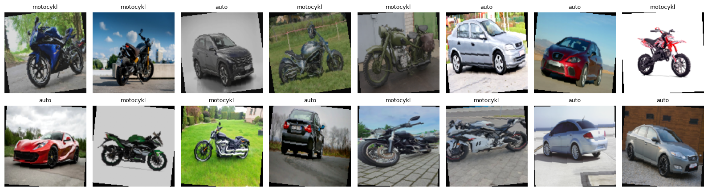
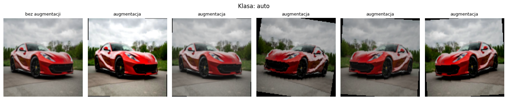

# Sprawozdanie laboratoryjne

**Przedmiot:** Uczenie głębokie do rozpoznawania obiektów
**Zajęcia nr / temat:** 3 / Dane obrazowe i wideo: potok i własny zbiór
**Autor / grupa:** Maciej Próchniak / Gr.3
**Data:** 02.11.2026

## 1. Cel ćwiczenia

Celem ćwiczenia było przygotowanie własnego mini-zbioru obrazów i kompletnego potoku danych: od plików w folderach, przez transformacje, do paczek tensorów z DataLoadera. Potok obejmuje wariant ewaluacyjny bez augmentacji i treningowy z augmentacją, statystyki zbioru oraz podgląd paczki i działania augmentacji.

Wybrałem dwie klasy pojazdów: auto i motocykl. Są to klasy wyraźnie różne, a jednocześnie każda obejmuje pojazdy o bardzo różnym wyglądzie, więc łatwo zebrać zróżnicowane zdjęcia.

## 2. Metoda i implementacja

**Narzędzia.** PyTorch, torchvision, Pillow i matplotlib.

**Zbiór danych.** Zbiór składa się z 68 zdjęć pobranych z internetu, po 34 w każdej klasie. Zdjęcia są w układzie ImageFolder: folder dane zawiera bezpośrednio foldery klas auto i motocykl, a nazwy plików ujednolicono (auto_001.jpg … auto_034.jpg, motocykl_001.jpg … motocykl_034.jpg). Wybierano zdjęcia, na których jeden pojazd jest głównym obiektem, nie ma drugiej klasy i nie widać twarzy. Pojazdy różnią się marką, typem, kolorem, ujęciem i tłem, a klasa motocykl obejmuje także skutery, crossy i choppery. Zdjęcia mają różne rozmiary (od 240 × 240 do 2835 × 2126 pikseli) i proporcje. Zbiór jest spakowany do pliku dane_lab3.zip, który notatnik wczytuje przy uruchomieniu (files.upload()) i rozpakowuje.

**Transformacje.** Oba warianty sprowadzają obraz do rozmiaru 128 × 128 i normalizują go wartościami średniej (0,485, 0,456, 0,406) i odchylenia standardowego (0,229, 0,224, 0,225) dla kanałów RGB, typowymi dla zdjęć. Resize((128, 128)) zmniejsza całe zdjęcie bez przycinania, więc pojazd nie zostaje ucięty, ale zmieniają się proporcje. Augmentacja występuje tylko w wariancie treningowym:

| Krok | Wariant ewaluacyjny | Wariant treningowy |
|---|---|---|
| zmiana rozmiaru | Resize((128, 128)) | Resize((128, 128)) |
| odbicie w poziomie | brak | RandomHorizontalFlip() z prawdopodobieństwem 0,5 |
| obrót | brak | RandomRotation(10), kąt od -10° do 10° |
| zmiana kolorów | brak | ColorJitter(brightness=0.2, contrast=0.2, saturation=0.2) |
| tensor i normalizacja | ToTensor(), Normalize | ToTensor(), Normalize |

Wszystkie trzy augmentacje zachowują etykietę: odbite lustrzanie, lekko obrócone albo jaśniejsze auto nadal jest autem, a motocykl motocyklem.

**Wczytanie.** Zbiór wczytano dwa razy przez ImageFolder z tego samego folderu: z transformacją ewaluacyjną i treningową. Każdy wariant ma własny DataLoader z paczkami po 16 obrazów: treningowy z tasowaniem (shuffle=True), a ewaluacyjny bez tasowania. Przed wczytaniem ustawiono torch.manual_seed(0), żeby tasowanie i augmentacja dawały te same wyniki przy kolejnym uruchomieniu.

**Kod.** Cały kod znajduje się w pliku lab3_Maciej_Próchniak.ipynb w folderze Lab3 repozytorium: https://github.com/mprochniak1/Rozpoznawanie_obiektow/tree/main/Lab3

## 3. Wyniki

**Statystyki zbioru:**

| Statystyka | Wartość |
|---|---|
| liczba klas | 2 |
| auto | 34 obrazy |
| motocykl | 34 obrazy |
| razem | 68 obrazów |
| rozmiar po transformacji | 3 × 128 × 128 |
| class_to_idx | {'auto': 0, 'motocykl': 1} |

Mapowanie class_to_idx jest takie samo w wariancie ewaluacyjnym i treningowym.

**Sprawdzenie paczki.** Paczka ewaluacyjna i treningowa mają kształt (16, 3, 128, 128), a wektor etykiet (16,). Etykiety w pierwszej paczce treningowej to [1, 1, 0, 1, 1, 0, 0, 1, 0, 1, 1, 0, 1, 1, 0, 0], czyli 9 motocykli i 7 aut.

**Siatka obrazów z paczki treningowej** (po odwróceniu normalizacji, nad obrazem nazwa klasy z etykiety):

**Podgląd augmentacji na jednym obrazie** (auto_001.jpg, pierwszy obraz bez augmentacji, pozostałe po transformacji treningowej):

## 4. Analiza i interpretacja

**Zbiór i statystyki.** Obie klasy mają po 34 obrazy, więc zbiór jest zbalansowany, a każda klasa ma ponad 30 obrazów. ImageFolder nadaje indeksy klas alfabetycznie według nazw folderów (auto 0, motocykl 1). Oba warianty mają to samo mapowanie, więc etykieta obrazu nie zależy od tego, którą transformacją został wczytany.

**Paczka.** Kształt (16, 3, 128, 128) zgadza się z ustawieniami: 16 obrazów w paczce, 3 kanały RGB i rozmiar 128 × 128 po transformacji. Na siatce każda nazwa klasy pasuje do pojazdu na obrazie, więc etykiety są przypisane poprawnie. Dzięki tasowaniu w paczce treningowej są obie klasy (9 motocykli i 7 aut). W wariancie ewaluacyjnym kolejność obrazów jest stała, bo ten wariant służy tylko do oceny.

**Augmentacja.** Na siatce i podglądzie widać odbicia lustrzane, lekkie obroty z czarnymi narożnikami oraz zmiany jasności, kontrastu i nasycenia. Pojazd na każdej wersji jest nadal dobrze widoczny i rozpoznawalny, więc augmentacja zmienia wygląd obrazu, a nie jego klasę. Czarne narożniki pojawiają się tylko w wariancie treningowym i są skutkiem obrotu.

**Rozmiar po transformacji.** Sprowadzenie wszystkich zdjęć do kwadratu 128 × 128 zmienia ich proporcje: zdjęcia poziome są ściśnięte w poziomie, a pionowe w pionie, co na siatce widać po węższych sylwetkach części aut. Przy 128 pikselach znikają też drobne szczegóły, chociaż kształt pojazdu nadal jest czytelny.

**Ograniczenia.** Zbiór jest mały (68 obrazów), więc nie obejmuje wszystkich typów pojazdów, ujęć i warunków oświetlenia. Zdjęcia mają różną jakość i rozdzielczość, a na kilku, głównie motocykli, widać znaki wodne. Przy uczeniu sieci takie elementy albo typowe tło danej klasy mogłyby stać się dla modelu wskazówką niezwiązaną z samym pojazdem. Zbiór nie jest też podzielony na część treningową i walidacyjną.

## 5. Wnioski

Przygotowany zbiór 68 zdjęć (po 34 aut i motocykli) w układzie ImageFolder wczytuje się poprawnie: class_to_idx ma postać {'auto': 0, 'motocykl': 1} w obu wariantach, a paczki mają kształt (16, 3, 128, 128). Augmentacja w wariancie treningowym zmienia orientację, położenie i kolory obrazu, ale nie zmienia jego klasy. Ograniczeniem może być mały rozmiar zbioru, zmiana proporcji przy Resize((128, 128)) oraz znaki wodne na części zdjęć. Poprawę mogłoby dać zebranie większej liczby zdjęć bez znaków wodnych, zachowanie proporcji (np. dopełnienie obrazu do kwadratu przed zmianą rozmiaru) oraz podział zbioru na część treningową i walidacyjną przed uczeniem sieci.
