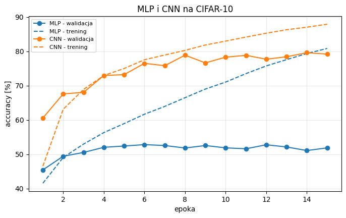

# Sprawozdanie laboratoryjne

**Przedmiot:** Uczenie głębokie do rozpoznawania obiektów
**Zajęcia nr / temat:** 4 / CNN - splotowe sieci dla obrazów
**Autor / grupa:** Maciej Próchniak / Gr.3
**Data:** 10.11.2026

## 1. Cel ćwiczenia

Celem ćwiczenia było porównanie sieci splotowej (CNN) z siecią MLP na zbiorze CIFAR-10 i sprawdzenie, jak wykorzystanie struktury obrazu wpływa na accuracy, liczbę parametrów i czas uczenia. Oba modele uczyłem w tych samych warunkach, a wyniki odniosłem też do losowego wyboru klasy, który przy 10 klasach daje ok. 10% accuracy.

## 2. Metoda i implementacja

**Narzędzia i sprzęt.** PyTorch 2.14.1, torchvision, matplotlib i pandas. Oba modele uczono na karcie graficznej NVIDIA Tesla T4.

**Dane.** CIFAR-10 zawiera 60 000 kolorowych obrazów 32 × 32 (3 kanały RGB) w 10 klasach: 50 000 treningowych i 10 000 testowych. Z części treningowej wydzielono na stałe 5 000 obrazów walidacyjnych (losowa permutacja z torch.Generator().manual_seed(42)), więc do uczenia zostało 45 000 obrazów. Obrazy zamieniono na tensory i znormalizowano średnią (0,4914, 0,4822, 0,4465) i odchyleniem standardowym (0,2470, 0,2435, 0,2616) dla kanałów RGB. Augmentacji nie było. Podział i przetwarzanie były takie same dla obu modeli.

**Modele.**

| Model | Budowa | Liczba parametrów |
|---|---|---:|
| MLP | spłaszczenie obrazu do 3072 wartości (3 × 32 × 32), warstwy gęste 3072, 512, 256 i 10 neuronów z ReLU | 1 707 274, w tym 1 573 376 w pierwszej warstwie |
| CNN | dwa bloki splotowe (32 i 64 filtry), w każdym dwa sploty 3 × 3 z padding=1, po każdym BatchNorm i ReLU, a na końcu bloku MaxPool2d(2), co zmniejsza mapy cech z 32 × 32 do 16 × 16 i 8 × 8; potem spłaszczenie do 4096 wartości (64 × 8 × 8), warstwa gęsta 4096 na 256 z ReLU, dropout 0,3 i warstwa wyjściowa 256 na 10 | 1 117 354, w tym 65 568 w warstwach splotowych |

**Konfiguracja.** CrossEntropyLoss, optymalizator Adam (lr = 1e-3), paczki po 128 obrazów (trening) i 256 (ocena), 15 epok dla każdego modelu, torch.manual_seed(0) przed utworzeniem każdego modelu. Po każdej epoce liczono accuracy walidacyjną, a na końcu przywrócono wagi z epoki o najwyższej accuracy walidacyjnej. Accuracy testową policzono raz, po wyborze epoki. Accuracy treningową liczono w trakcie epoki, na kolejnych paczkach, w trybie uczenia (u CNN z aktywnym dropoutem). Czas uczenia to suma czasów przejść przez 45 000 obrazów treningowych we wszystkich 15 epokach, bez oceny na walidacji. Obejmuje on wczytywanie paczek przez DataLoader (2 procesy) i obliczenia na GPU.

**Kod.** Cały kod znajduje się w pliku lab4_Maciej_Próchniak.ipynb w folderze Lab4 repozytorium: https://github.com/mprochniak1/Rozpoznawanie_obiektow/tree/main/Lab4

## 3. Wyniki

Wykres pokazuje accuracy treningową (linie przerywane) i walidacyjną (linie z punktami) obu modeli w kolejnych epokach. Krzywa walidacyjna CNN przez cały trening leży wyraźnie nad krzywą MLP. Już po pierwszej epoce CNN miała 60,58% accuracy walidacyjnej, a MLP 45,44%. Najwyższą accuracy walidacyjną MLP osiągnęła w 6. epoce (52,80%), a CNN w 14. epoce (79,60%).

| Model | Liczba parametrów | Wybrana epoka | Accuracy walidacyjna [%] | Accuracy testowa [%] | Czas uczenia [s] |
|---|---:|---:|---:|---:|---:|
| MLP | 1 707 274 | 6 | 52,80 | 51,99 | 141,0 |
| CNN | 1 117 354 | 14 | 79,60 | 78,87 | 160,3 |

CNN uzyskała accuracy testową 78,87%, czyli o 26,88 punktu procentowego więcej niż MLP (51,99%), mając przy tym ok. 35% mniej parametrów. Uczenie CNN trwało 160,3 s, a MLP 141,0 s, czyli CNN uczyła się ok. 14% dłużej. Oba modele są wyraźnie lepsze od losowego wyboru klasy (10%): MLP ok. 5,2 razy, a CNN ok. 7,9 razy.

## 4. Analiza i interpretacja

**Lokalność i współdzielenie wag.** W MLP każdy z 512 neuronów pierwszej warstwy jest połączony z każdą z 3072 wartości wejścia, więc sama ta warstwa ma 1 573 376 parametrów. Każda waga dotyczy jednego konkretnego piksela i kanału, więc ten sam wzorzec, np. krawędź albo koło, sieć musi uczyć się osobno dla każdego miejsca obrazu. Filtr splotowy 3 × 3 patrzy tylko na małe sąsiedztwo piksela (lokalność), a ten sam filtr jest przykładany w każdym miejscu obrazu (współdzielenie wag). Dlatego cztery warstwy splotowe mają razem tylko 65 568 parametrów, ok. 24 razy mniej niż pierwsza warstwa MLP. Wzorzec wykryty w jednym miejscu jest rozpoznawany także w innym, a pooling dodatkowo zmniejsza wrażliwość na małe przesunięcia. Prawdopodobnie dlatego CNN już po pierwszej epoce (60,58%) przewyższa MLP po wszystkich 15 epokach (najwyżej 52,80%).

**Wpływ BatchNorm i dropoutu.** CNN ma dodatkowo BatchNorm i dropout, a MLP nie ma żadnej normalizacji ani regularyzacji. Część przewagi CNN może więc wynikać z tych elementów, a nie tylko ze splotów. BatchNorm mógł przyspieszyć uczenie, zwłaszcza w pierwszych epokach, a dropout ograniczyć przeuczenie. Na podstawie tego porównania nie da się dokładnie rozdzielić tych efektów.

**Liczba parametrów.** Mimo przewagi w accuracy CNN ma mniej parametrów niż MLP. Ok. 94% z nich (1 048 832) to warstwa gęsta 4096 na 256, a warstwy splotowe to tylko ok. 6%. Spłaszczenie dopiero po zmniejszeniu map cech do 8 × 8 sprawia, że ta warstwa jest mniejsza niż pierwsza warstwa MLP, która działa na całym obrazie 32 × 32.

**Przeuczenie.** MLP przeucza się wyraźnie: accuracy walidacyjna po 6. epoce waha się między 51,08% a 52,76%, a accuracy treningowa rośnie do 80,85%. U CNN accuracy walidacyjna od 8. epoki waha się między 76,64% a 79,60%, ale jeszcze powoli rośnie, a treningowa dochodzi do 87,91%. W wybranej epoce różnica między accuracy treningową a walidacyjną wynosi 8,87 punktu procentowego dla MLP i 7,44 dla CNN, chociaż CNN ma znacznie wyższą accuracy. Mniejsza różnica u CNN może wynikać z dropoutu, który dodatkowo obniża accuracy treningową liczoną w trybie uczenia. Najlepsza epoka CNN wypadła dopiero w 14. epoce, więc dłuższe uczenie mogłoby jeszcze trochę poprawić wynik. W 1. epoce accuracy treningowa obu modeli jest niższa niż walidacyjna, bo liczono ją w trakcie epoki, kiedy model był jeszcze słabszy.

**Czas uczenia.** CNN uczyła się tylko o 19,3 s dłużej, chociaż ma cztery warstwy splotowe, a każda waga filtra jest używana w wielu miejscach obrazu. Jedna epoka trwała ok. 9,4 s dla MLP i ok. 10,7 s dla CNN. Przy tak małych sieciach dużą część tego czasu zajmuje prawdopodobnie wczytywanie i przekształcanie paczek na procesorze, które jest takie samo dla obu modeli. Różnica w samych obliczeniach na GPU może więc być względnie większa, niż pokazuje zmierzony czas.

**Wynik testowy.** Accuracy testowa jest nieco niższa od walidacyjnej: o 0,81 punktu procentowego dla MLP i o 0,73 dla CNN. Może to wynikać z tego, że epokę wybrano na walidacji, więc wynik walidacyjny jest lekko zawyżony. Kolejność modeli na teście jest taka sama jak na walidacji.

**Ograniczenia.** Każdy model uruchomiłem raz, więc wyniki i czasy mogą się trochę różnić między uruchomieniami. Czas zmierzono jednorazowo i obejmuje on wczytywanie danych. CNN ma BatchNorm i dropout, których nie ma MLP, więc nie da się dokładnie oddzielić wpływu splotów od wpływu tych elementów.

## 5. Wnioski

CNN osiągnęła accuracy testową 78,87% wobec 51,99% dla MLP, czyli o 26,88 punktu procentowego więcej, przy mniejszej liczbie parametrów (1 117 354 wobec 1 707 274). Przewaga wynika prawdopodobnie z lokalności i współdzielenia wag: cztery warstwy splotowe mają razem 65 568 parametrów, a sama pierwsza warstwa MLP 1 573 376. Część różnicy może jednak dawać BatchNorm i dropout, które ma tylko CNN. Czas uczenia był zbliżony (160,3 s wobec 141,0 s na Tesla T4), co może oznaczać, że dużą część czasu zajmowało wczytywanie danych. MLP wyraźnie przeucza się już po 6. epoce, a accuracy walidacyjna CNN rosła jeszcze do 14. epoki, więc poprawę mogłoby dać dłuższe uczenie CNN, augmentacja danych albo regularyzacja MLP.
