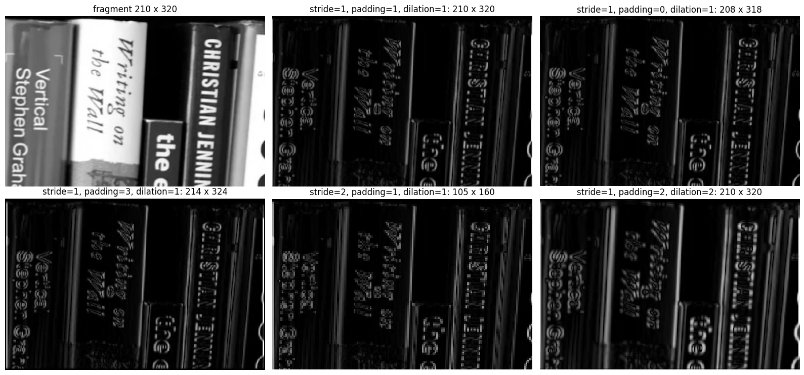
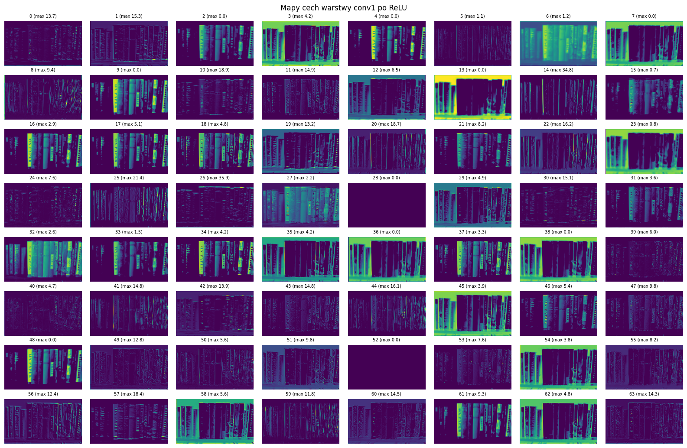

# Sprawozdanie laboratoryjne

**Przedmiot:** Uczenie głębokie do rozpoznawania obiektów
**Zajęcia nr / temat:** 5 / Warstwy splotowe - operacja, parametry, interpretacja
**Autor / grupa:** Maciej Próchniak / Gr.3
**Data:** 18.11.2026

## 1. Cel ćwiczenia

Celem ćwiczenia było zbadanie działania warstwy splotowej na jednym zdjęciu w skali szarości. Sprawdziłem, co robią ręcznie dobrane jądra, jak rozmiar jądra, stride, padding i dilation wpływają na rozmiar wyjścia, na co reagują filtry pierwszej warstwy pretrenowanej sieci oraz czym różnią się filtry rozmywające Box i Gaussian.

## 2. Metoda i implementacja

**Zdjęcie.** Półka z książkami, 1500 × 867 pikseli, zamieniona na skalę szarości (wartości 0-1). Do badania parametrów splotu i porównania rozmyć użyto fragmentu 210 × 320 pikseli zaznaczonego czerwoną ramką, z napisami „Writing on the Wall” i „CHRISTIAN JENNINGS”.

**Narzędzia.** PyTorch 2.14.1, torchvision, matplotlib, pandas i Pillow.

**Konfiguracja.** Jądra 3 × 3 (Sobel X, Sobel Y, Laplacian i wyostrzanie) zastosowano przez F.conv2d z padding=1. Mapy ze znakiem pokazano paletą wyśrodkowaną w zerze, ze wspólną skalą dla Sobela X i Y. Rozmiar wyjścia dla sześciu kombinacji k, stride, padding i dilation policzono ze wzoru out = (in + 2p - d(k - 1) - 1) / s + 1 (zaokrąglenie w dół) i porównano z nn.Conv2d. Wpływ stride, padding i dilation pokazano dla Sobela X na fragmencie. Mapy cech pochodzą z pierwszej warstwy (conv1, 64 filtry 7 × 7) pretrenowanego ResNet-18. Zdjęcie zmniejszono do 224 × 388, podano tę samą skalę szarości w trzech kanałach i znormalizowano wartościami ImageNet. Filtry Box 3 × 3, Box 5 × 5 i Gaussian 5 × 5 zastosowano ze stride=1, dilation=1 i padding równym k // 2, a fragment pokazano na wspólnej skali jasności 0-1.

**Kod.** Cały kod znajduje się w pliku lab5_Maciej_Próchniak.ipynb w folderze Lab5 repozytorium: https://github.com/mprochniak1/Rozpoznawanie_obiektow/tree/main/Lab5

## 3. Wyniki

Sobel X zaznacza pionowe krawędzie grzbietów, a Sobel Y poziome krawędzie i napisy na grzbietach. Magnituda pokazuje kontury wszystkich książek i liter, Laplacian cienkie linie wzdłuż krawędzi, a po wyostrzaniu napisy są ostrzejsze.

| k | stride | padding | dilation | Wzór | nn.Conv2d |
|---:|---:|---:|---:|---|---|
| 3 | 1 | 0 | 1 | 865 × 1498 | 865 × 1498 |
| 3 | 1 | 1 | 1 | 867 × 1500 | 867 × 1500 |
| 5 | 2 | 2 | 1 | 434 × 750 | 434 × 750 |
| 3 | 1 | 2 | 2 | 867 × 1500 | 867 × 1500 |
| 7 | 3 | 0 | 1 | 287 × 498 | 287 × 498 |
| 4 | 2 | 1 | 3 | 430 × 747 | 430 × 747 |

Dla wejścia 867 × 1500 wynik wzoru zgadza się z nn.Conv2d we wszystkich przypadkach.

Fragment 210 × 320 daje mapę 210 × 320 przy padding=1, 208 × 318 przy padding=0, 214 × 324 przy padding=3, 105 × 160 przy stride=2 i 210 × 320 przy dilation=2 z padding=2.

Najsilniejsze odpowiedzi dały mapy 26 (maksimum 35,9) i 14 (34,8), a dziesięć map ma maksimum 0,0.

Wszystkie trzy filtry zachowały rozmiar 867 × 1500. Gaussian 5 × 5 ma wagi od 36/256 w środku do 1/256 w rogach.

## 4. Analiza i interpretacja

**Ręczne jądra.** Sobel X reaguje na zmianę jasności w poziomie, czyli na pionowe krawędzie, a Sobel Y na poziome. Napisy na grzbietach są obrócone, dlatego wiele kresek liter jest poziomych i lepiej widać je w Sobelu Y. Laplacian ma sumę wag równą zero, więc na jednolitych powierzchniach daje zero. Wyostrzanie zwiększa lokalny kontrast, bo środek ma wagę 5, a sąsiedzi -1.

**Stride, padding i dilation.** Bez dopełnienia mapa jest mniejsza o 2 piksele w każdej osi, a przy padding=3 większa od wejścia. Na jej bocznych brzegach widać jasne linie, bo Sobel X reaguje na przejście od zer dopełnienia do zdjęcia. Stride=2 zmniejsza mapę o połowę, więc litery wyglądają bardziej kanciasto. Dilation=2 rozsuwa wagi co dwa piksele, więc okno obejmuje obszar 5 × 5 przy 9 wagach, a krawędzie na mapie są szersze.

**Mapy cech.** Filtry z pionowymi pasami (np. 14, 20, 41) zaznaczają krawędzie grzbietów, a filtry z poziomymi pasami (np. 10, 26, 30) górne brzegi książek, półkę i poziome kreski liter. Filtry o drobnym, ukośnym wzorze (np. 39, 49, 63) reagują na napisy i tekstury, a gładkie filtry na jasne grzbiety albo ciemne tło. Filtry kolorowe (np. 5, 6, 28, 52) prawie nie reagują, bo zdjęcie ma we wszystkich kanałach tę samą wartość. Mapy z maksimum 0,0 pochodzą głównie od filtrów o wagach bliskich zeru.

**Box i Gaussian.** Box 5 × 5 rozmywa wyraźnie mocniej niż Box 3 × 3: cienkie litery „Writing on the Wall” zlewają się, a krawędzie grzbietów są szersze. Gaussian 5 × 5 rozmywa słabiej niż Box 5 × 5 przy tym samym oknie, a litery pozostają czytelne. Wynika to z rozkładu wag: Gaussian ma ok. 77% wagi w środkowym obszarze 3 × 3, a Box 5 × 5 tylko 36%, więc dalsze piksele mają u niego dużo większy wpływ.

## 5. Wnioski

Ręczne jądra działają zgodnie ze swoimi wagami: Sobel X i Y wykrywają pionowe i poziome krawędzie, Laplacian zmiany jasności, a wyostrzanie zwiększa kontrast. Wzór na rozmiar wyjścia zgadza się z nn.Conv2d we wszystkich sześciu przypadkach, a stride zmniejsza mapę, padding ją zachowuje lub powiększa, a dilation poszerza zasięg okna bez dodawania wag. Filtry conv1 ResNet-18 przypominają detektory krawędzi i tekstur, a Gaussian 5 × 5 rozmywa słabiej niż Box 5 × 5, prawdopodobnie dzięki skupieniu wag w środku okna.
