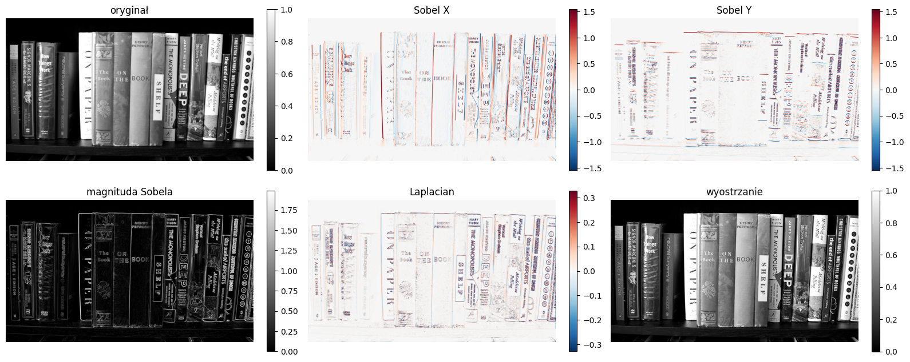
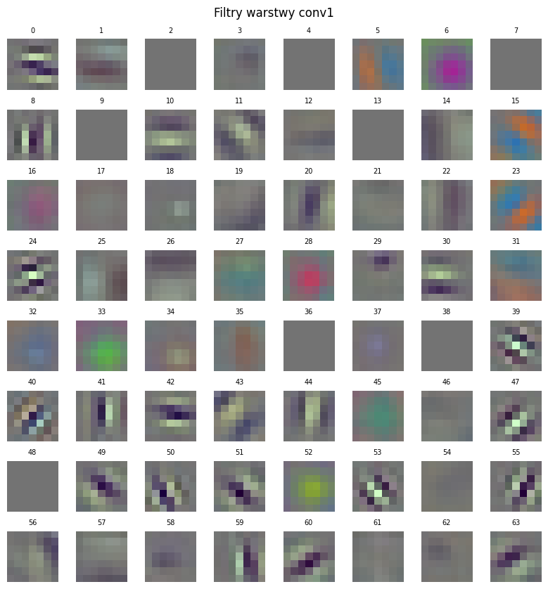
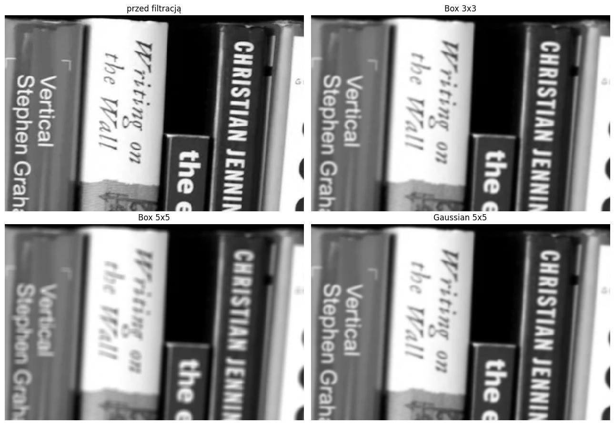

# Sprawozdanie laboratoryjne

**Przedmiot:** Uczenie głębokie do rozpoznawania obiektów
**Zajęcia nr / temat:** 5 / Warstwy splotowe - operacja, parametry, interpretacja
**Autor / grupa:** Maciej Próchniak / Gr.3
**Data:** 18.11.2026

## 1. Cel ćwiczenia

Celem ćwiczenia było zbadanie działania warstwy splotowej na jednym zdjęciu w skali szarości. Sprawdziłem, co robią ręcznie dobrane jądra, jak rozmiar jądra, stride, padding i dilation wpływają na rozmiar wyjścia, na co reagują filtry pierwszej warstwy pretrenowanej sieci oraz czym różnią się filtry rozmywające Box i Gaussian.

## 2. Metoda i implementacja

**Zdjęcie.** Wszystkie punkty wykonano na tym samym zdjęciu półki z książkami o rozmiarze 1500 × 867 pikseli. Zdjęcie zamieniono na skalę szarości (wartości od 0 do 1, tensor 1 × 1 × 867 × 1500). Ma ono pionowe krawędzie grzbietów, poziome krawędzie półki i górnych brzegów książek oraz napisy różnej wielkości. Do badania parametrów splotu i porównania rozmyć wybrano fragment 210 × 320 pikseli (wiersze 90-300, kolumny 1140-1460) z napisami „Writing on the Wall” i „CHRISTIAN JENNINGS”, zaznaczony czerwoną ramką.

**Narzędzia.** PyTorch 2.14.1, torchvision, matplotlib, pandas i Pillow.

**Ręczne jądra.** Przez F.conv2d z padding=1 zastosowano jądra 3 × 3: Sobel X ([[-1, 0, 1], [-2, 0, 2], [-1, 0, 1]]), Sobel Y (transpozycja Sobela X), Laplacian ([[0, 1, 0], [1, -4, 1], [0, 1, 0]]) i wyostrzanie ([[0, -1, 0], [-1, 5, -1], [0, -1, 0]], wynik obcięty do zakresu 0-1). Z odpowiedzi Sobela policzono magnitudę sqrt(gx² + gy²). Mapy ze znakiem pokazano paletą czerwono-niebieską wyśrodkowaną w zerze, ze wspólną skalą dla Sobela X i Y, ograniczoną do 99. percentyla wartości bezwzględnych.

**Wymiary wyjścia.** Dla sześciu kombinacji k, stride, padding i dilation policzono rozmiar wyjścia ze wzoru out = (in + 2p - d(k - 1) - 1) / s + 1 (zaokrąglenie w dół), osobno dla wysokości i szerokości całego zdjęcia, i porównano go z rozmiarem wyjścia nn.Conv2d.

**Parametry splotu.** Sobel X zastosowano do wybranego fragmentu przy pięciu ustawieniach stride, padding i dilation. Pokazano wartość bezwzględną odpowiedzi na wspólnej skali.

**Mapy cech.** Użyto pretrenowanego ResNet-18 (wagi ResNet18_Weights.DEFAULT) i jego pierwszej warstwy splotowej conv1 (64 filtry 7 × 7, stride=2, padding=3). Zdjęcie zmniejszono do 224 × 388 z zachowaniem proporcji, tę samą skalę szarości podano w trzech kanałach i znormalizowano średnią i odchyleniem ze zbioru ImageNet. Mapy cech po ReLU mają rozmiar 64 × 112 × 194. Każda mapa ma własną skalę kolorów, a w tytule podano jej wartość maksymalną.

**Filtry rozmywające.** Box 3 × 3 (wszystkie wagi 1/9), Box 5 × 5 (wagi 1/25) i Gaussian 5 × 5 (iloczyn zewnętrzny wektora [1, 4, 6, 4, 1] z samym sobą, podzielony przez 256) zastosowano przez F.conv2d ze stride=1 i dilation=1. Padding dobrano jako k // 2 (1, 2 i 2), więc wszystkie wyniki mają rozmiar 867 × 1500. Ten sam fragment pokazano przed filtracją i po każdym filtrze na wspólnej skali jasności 0-1.

**Kod.** Cały kod znajduje się w pliku lab5_Maciej_Próchniak.ipynb w folderze Lab5 repozytorium: https://github.com/mprochniak1/Rozpoznawanie_obiektow/tree/main/Lab5

## 3. Wyniki

### Ręczne jądra

Sobel X najmocniej zaznacza długie pionowe krawędzie grzbietów, a Sobel Y górne brzegi książek, krawędź półki i napisy biegnące wzdłuż grzbietów. Na obu mapach kolor czerwony oznacza wartości dodatnie, a niebieski ujemne. Magnituda pokazuje kontury wszystkich książek i liter, a najjaśniejsza jest przy białych etykietach i jasnych grzbietach na ciemnym tle. Laplacian daje cienkie pary linii dodatnich i ujemnych wzdłuż krawędzi i liter, a jego wartości (99. percentyl ok. 0,32) są wyraźnie mniejsze niż u Sobela (ok. 1,55). Po wyostrzaniu zdjęcie wygląda jak oryginał, ale napisy i krawędzie są ostrzejsze.

### Wymiary wyjścia

Wejście: 867 × 1500.

| k | stride | padding | dilation | Wzór | nn.Conv2d |
|---:|---:|---:|---:|---|---|
| 3 | 1 | 0 | 1 | 865 × 1498 | 865 × 1498 |
| 3 | 1 | 1 | 1 | 867 × 1500 | 867 × 1500 |
| 5 | 2 | 2 | 1 | 434 × 750 | 434 × 750 |
| 3 | 1 | 2 | 2 | 867 × 1500 | 867 × 1500 |
| 7 | 3 | 0 | 1 | 287 × 498 | 287 × 498 |
| 4 | 2 | 1 | 3 | 430 × 747 | 430 × 747 |

We wszystkich sześciu przypadkach wynik wzoru zgadza się z rozmiarem wyjścia nn.Conv2d.

### Stride, padding i dilation

| Ustawienie | Rozmiar wyjścia |
|---|---|
| stride=1, padding=1, dilation=1 | 210 × 320 |
| stride=1, padding=0, dilation=1 | 208 × 318 |
| stride=1, padding=3, dilation=1 | 214 × 324 |
| stride=2, padding=1, dilation=1 | 105 × 160 |
| stride=1, padding=2, dilation=2 | 210 × 320 |

### Mapy cech ResNet-18

Najsilniejsze odpowiedzi dały mapy 26 (maksimum 35,9) i 14 (34,8). Dziesięć map (2, 4, 7, 9, 13, 28, 36, 38, 48 i 52) ma maksimum 0,0 po zaokrągleniu.

### Filtry rozmywające

Wagi Gaussian 5 × 5 pomnożone przez 256 to [1, 4, 6, 4, 1], [4, 16, 24, 16, 4], [6, 24, 36, 24, 6], [4, 16, 24, 16, 4] i [1, 4, 6, 4, 1]. Wszystkie trzy filtry zachowały rozmiar zdjęcia 867 × 1500.

## 4. Analiza i interpretacja

**Ręczne jądra.** Sobel X porównuje lewą i prawą kolumnę okna, więc reaguje na zmianę jasności w poziomie, czyli na pionowe krawędzie. Dodatnia odpowiedź oznacza wzrost jasności w prawo, np. na lewym brzegu jasnego grzbietu. Sobel Y porównuje górny i dolny wiersz, więc reaguje na poziome krawędzie. Napisy na grzbietach są obrócone o 90°, dlatego wiele kresek liter jest poziomych i Sobel Y pokazuje je wyraźniej niż Sobel X. Magnituda łączy oba kierunki i zaznacza każdą krawędź niezależnie od orientacji. Laplacian ma sumę wag równą zero, więc na jednolitych powierzchniach daje zero, a reaguje na szybkie zmiany jasności w obu kierunkach. Wyostrzanie zwiększa lokalny kontrast: środek ma wagę 5, a sąsiedzi -1, więc piksel jaśniejszy od otoczenia staje się jeszcze jaśniejszy.

**Stride, padding i dilation.** Bez dopełnienia mapa traci po jednym pikselu z każdej strony (208 × 318). Przy padding=3 mapa jest większa od wejścia (214 × 324), a przy lewym i prawym brzegu widać jasne pionowe linie, bo Sobel X reaguje na skok od zer dopełnienia do jasności zdjęcia. Stride=2 zmniejsza mapę o połowę w każdej osi (105 × 160): litery wyglądają bardziej kanciasto, a cienkie linie są częściowo poprzerywane. Dilation=2 rozsuwa wagi jądra co dwa piksele, więc okno obejmuje obszar 5 × 5 przy nadal 9 wagach. Krawędzie na mapie są szersze i jaśniejsze, a przy padding=2 rozmiar mapy się nie zmienia.

**Mapy cech.** Filtry conv1 można podzielić na kilka grup, co widać też na mapach. Filtry z pionowymi pasami (np. 14, 20, 22, 41, 44, 59) reagują na pionowe krawędzie grzbietów, a filtry z poziomymi pasami (np. 0, 10, 26, 30, 42) na górne brzegi książek, krawędź półki i poziome kreski liter. Mapa 26 ma najsilniejszą odpowiedź na górnej krawędzi książek. Filtry o drobnym, ukośnym lub szachownicowym wzorze (np. 39, 47, 49, 60, 63) reagują głównie na napisy i drobne tekstury okładek. Filtry bez wyraźnego wzoru reagują na duże obszary: część na jasne grzbiety i etykiety (np. 17, 21, 34), a część na ciemne tło nad książkami i półkę (np. 3, 35, 45, 58). Filtry kolorowe (np. 5, 6, 15, 23, 28, 52) reagują słabo albo wcale, bo zdjęcie ma we wszystkich kanałach tę samą wartość, a te filtry wykrywają różnice między kanałami. Mapy z maksimum 0,0 pochodzą głównie od filtrów o wagach bliskich zeru (jednolite szare kwadraty na rysunku filtrów), więc widoczny na nich wzór to efekt osobnej skali kolorów każdej mapy.

**Box 3 × 3 i Box 5 × 5.** Box 3 × 3 tylko lekko zmiękcza obraz i wszystkie napisy pozostają czytelne. Box 5 × 5 rozmywa wyraźnie mocniej: cienkie, pochyłe litery napisu „Writing on the Wall” zlewają się, a mniejszy napis „Stephen Graham” traci ostrość. Krawędzie grzbietów przechodzą z ciemnego w jasne na szerszym pasie pikseli. Większe okno uśrednia więcej sąsiednich pikseli, więc szczegóły mniejsze niż okno zanikają.

**Box 5 × 5 i Gaussian 5 × 5.** Przy tym samym rozmiarze okna Gaussian 5 × 5 rozmywa wyraźnie słabiej niż Box 5 × 5 i wygląda podobnie do Box 3 × 3. Litery „Writing on the Wall” pozostają czytelne, a krawędzie są węższe. Wynika to z rozkładu wag: w Box 5 × 5 każdy piksel ma wagę 0,04, więc zewnętrzny pierścień okna daje 64% wyniku. W Gaussianie środek ma wagę 36/256, czyli ok. 0,14, rogi tylko 1/256, a środkowe 3 × 3 skupia 196/256, czyli ok. 77% wagi. Dalsze piksele mają więc mały wpływ. W obu filtrach wagi sumują się do 1, więc jednolite obszary, np. biała etykieta, zachowują jasność.

## 5. Wnioski

Ręczne jądra robią to, co wynika z ich wag: Sobel X i Y wykrywają odpowiednio pionowe i poziome krawędzie, Laplacian reaguje na zmiany jasności w obu kierunkach, a wyostrzanie zwiększa lokalny kontrast. Wzór na wymiary wyjścia zgadza się z nn.Conv2d we wszystkich sześciu przypadkach. Stride zmniejsza mapę, padding zachowuje lub powiększa jej rozmiar kosztem odpowiedzi na brzegach, a dilation zwiększa zasięg okna bez dodawania wag. Filtry conv1 ResNet-18 przypominają ręczne detektory krawędzi i tekstur, a filtry kolorowe na zdjęciu w skali szarości prawie nie reagują. Gaussian 5 × 5 rozmywa słabiej niż Box 5 × 5, prawdopodobnie dlatego, że skupia ok. 77% wagi w środkowym obszarze 3 × 3, a Box tylko 36%.
