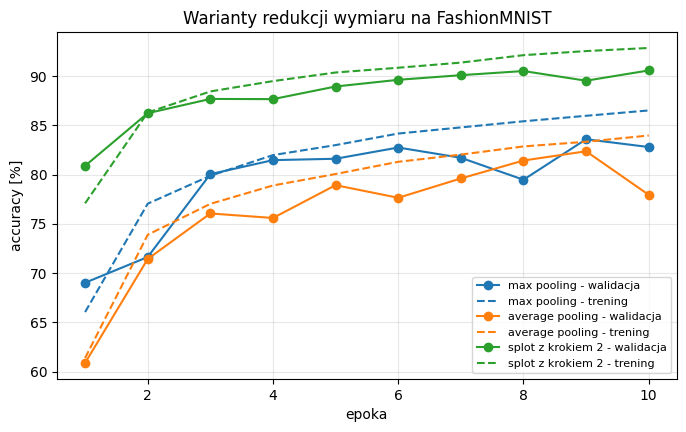

# Sprawozdanie laboratoryjne

**Przedmiot:** Uczenie głębokie do rozpoznawania obiektów
**Zajęcia nr / temat:** 6 / Warstwa łącząca (pooling) i pełna CNN
**Autor / grupa:** Maciej Próchniak / Gr.3
**Data:** 18.11.2026

## 1. Cel ćwiczenia

Celem ćwiczenia było zbudowanie pełnej sieci splotowej (bloki splot - BatchNorm - ReLU - redukcja, a na końcu global average pooling i warstwa gęsta) i sprawdzenie, jak sposób zmniejszania map cech wpływa na wynik i budowę sieci. Porównałem trzy warianty redukcji: max pooling, average pooling i splot z krokiem 2, pod względem accuracy, liczby parametrów i rozmiaru mapy cech przed głowicą klasyfikującą.

Pracowałem na zbiorze FashionMNIST, tak jak na zajęciach 1 i 2.

## 2. Metoda i implementacja

**Narzędzia i sprzęt.** PyTorch 2.14.1, torchvision, matplotlib i pandas. Modele uczono na karcie graficznej NVIDIA Tesla T4.

**Dane.** FashionMNIST: 60 000 obrazów treningowych i 10 000 testowych (28 × 28, skala szarości, 10 klas). Z części treningowej wydzielono na stałe 10 000 obrazów walidacyjnych (losowa permutacja z torch.Generator().manual_seed(42)), więc do uczenia zostało 50 000 obrazów. Obrazy zamieniono na tensory i znormalizowano (Normalize(0.2860, 0.3530)). Ten sam podział i przetwarzanie były użyte dla wszystkich wariantów.

**Model.** Sieć ma dwa bloki (32 i 64 filtry) i wspólną głowicę. Każdy blok zaczyna się od splotu 3 × 3 z padding=1, BatchNorm i ReLU, a kończy redukcją wymiaru:

| Wariant | Redukcja na końcu bloku | Liczba parametrów |
|---|---|---:|
| max pooling | MaxPool2d(2) | 19 658 |
| average pooling | AvgPool2d(2) | 19 658 |
| splot z krokiem 2 | splot 3 × 3 ze stride=2 i padding=1, BatchNorm i ReLU | 66 026 |

Głowica to AdaptiveAvgPool2d(1) (GAP), spłaszczenie i warstwa Linear(64, 10). We wszystkich wariantach kształty są takie same: wejście 1 × 28 × 28, po pierwszym bloku 32 × 14 × 14, po drugim 64 × 7 × 7, po GAP 64 wartości i na wyjściu 10 logitów. Pooling 2 × 2 dzieli wymiar na pół (28 na 14 i 14 na 7). Splot 3 × 3 ze stride=2 i padding=1 daje to samo, bo (28 + 2 - 3) / 2 + 1 = 14 po zaokrągleniu w dół, a dla 14 wychodzi 7.

**Konfiguracja.** CrossEntropyLoss, optymalizator Adam (lr = 1e-3), paczki po 128 obrazów (trening) i 256 (ocena), 10 epok dla każdego wariantu, torch.manual_seed(0) przed utworzeniem każdego modelu. Po każdej epoce liczono accuracy walidacyjną, a na końcu przywrócono wagi z epoki o najwyższej accuracy walidacyjnej. Accuracy testową policzono raz, po wyborze epoki. Accuracy treningową liczono w trakcie epoki, na kolejnych paczkach.

**Kod.** Cały kod znajduje się w pliku lab6_Maciej_Próchniak.ipynb w folderze Lab6 repozytorium: https://github.com/mprochniak1/Rozpoznawanie_obiektow/tree/main/Lab6

## 3. Wyniki

Wykres pokazuje accuracy treningową (linie przerywane) i walidacyjną (linie z punktami) trzech wariantów w kolejnych epokach. Wariant ze splotem z krokiem 2 ma najwyższą accuracy walidacyjną w każdej epoce. Już po pierwszej epoce osiągnął 80,88%, podczas gdy max pooling miał 69,02%, a average pooling 60,88%. Krzywe walidacyjne max i average poolingu są mniej stabilne: max pooling spadł w 8. epoce do 79,47%, a average pooling w 10. epoce do 77,94%.

| Wariant | Liczba parametrów | Mapa przed głowicą | Wybrana epoka | Accuracy walidacyjna [%] | Accuracy testowa [%] |
|---|---:|---|---:|---:|---:|
| max pooling | 19 658 | 64 × 7 × 7 | 9 | 83,58 | 83,80 |
| average pooling | 19 658 | 64 × 7 × 7 | 9 | 82,36 | 82,09 |
| splot z krokiem 2 | 66 026 | 64 × 7 × 7 | 10 | 90,56 | 89,78 |

Splot z krokiem 2 osiągnął accuracy testową 89,78%, czyli o 5,98 punktu procentowego więcej niż max pooling (83,80%) i o 7,69 więcej niż average pooling (82,09%). Ma przy tym ok. 3,4 razy więcej parametrów. Max pooling był lepszy od average poolingu o 1,71 punktu procentowego na teście i o 1,22 na walidacji, przy tej samej liczbie parametrów.

## 4. Analiza i interpretacja

**Liczba parametrów.** Max i average pooling nie mają uczonych parametrów, więc oba warianty mają po 19 658 parametrów. Splot z krokiem 2 dodaje 46 368 parametrów (dwa dodatkowe sploty i dwie warstwy BatchNorm). Mapa przed głowicą ma we wszystkich wariantach rozmiar 64 × 7 × 7, więc różnice w wynikach nie wynikają z jej rozmiaru.

**Kompromis jakość/parametry.** Splot z krokiem 2 daje najlepszy wynik, ale ma ok. 3,4 razy więcej parametrów. Przewaga może wynikać zarówno z uczonej redukcji, jak i z dwóch dodatkowych warstw splotowych, a w tym porównaniu nie da się tego rozdzielić. Jeśli liczy się mały model, rozsądniejszy wydaje się max pooling (83,80% przy 19 658 parametrach).

**Max i average pooling.** Max pooling był lepszy w 9 z 10 epok, prawdopodobnie dlatego, że przekazuje dalej najsilniejszą odpowiedź filtra, a średnia ją osłabia. Różnica 1,71 punktu procentowego jest jednak porównywalna z wahaniami walidacji między epokami (do 4,42 punktu), więc przy jednym uruchomieniu może częściowo wynikać z losowości.

**Uczenie.** Różnica między accuracy treningową a walidacyjną jest mała (od 0,96 do 2,38 punktu procentowego), a accuracy treningowa rosła jeszcze w 10. epoce, więc modele raczej się nie przeuczają. Accuracy testowa różni się od walidacyjnej o mniej niż 1 punkt procentowy.

## 5. Wnioski

Najwyższą accuracy testową osiągnął splot z krokiem 2 (89,78%), ale kosztem 66 026 parametrów wobec 19 658 dla wariantów z poolingiem. Max pooling (83,80%) wypadł nieco lepiej niż average pooling (82,09%), choć różnica może wynikać z losowości. Mapa przed głowicą ma we wszystkich wariantach rozmiar 64 × 7 × 7, a accuracy treningowa rosła jeszcze w 10. epoce, więc poprawę mogłoby dać dłuższe uczenie.
